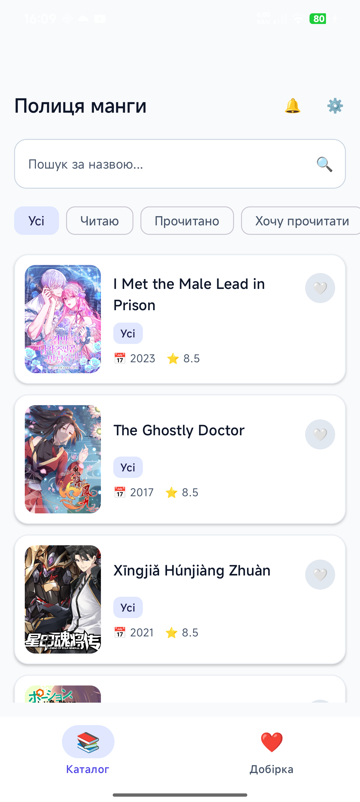
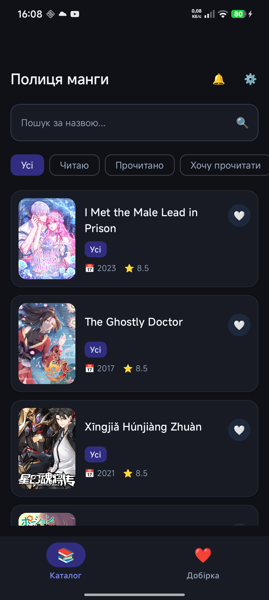
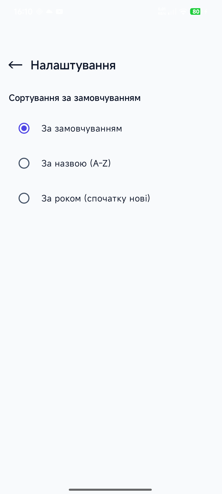
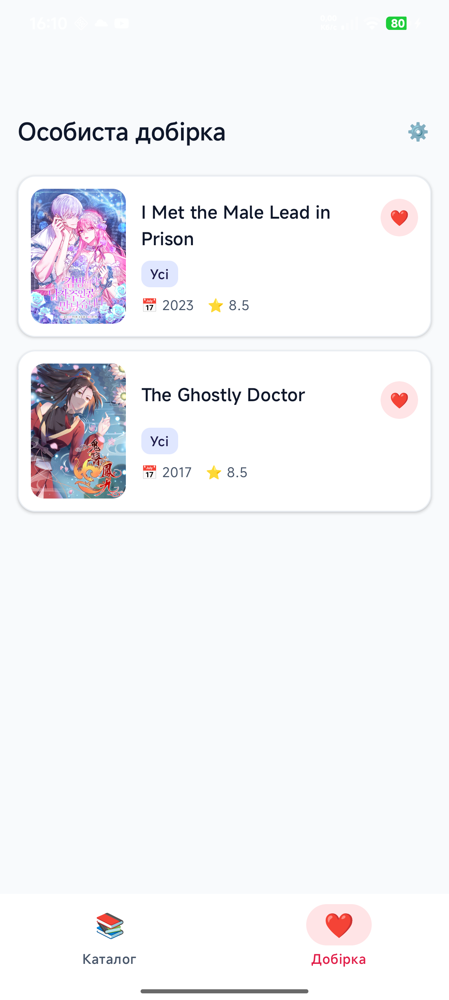

# Полиця манги (MangaShelf)

Мобільний Android-застосунок для перегляду каталогу манги, пошуку тайтлів та ведення особистої добірки обраного на базі **MangaDex API**.

## Основний функціонал
- Завантаження списку манги та обкладинок через REST API.
- Пошук за назвою з механізмом debounce (500 мс) та скасуванням попередніх запитів.
- Фільтрація за статусом читання (*Усі, Читаю, Прочитано, Хочу прочитати*) та сортування (*за замовчуванням, за назвою, за роком*).
- Локальне збереження обраних тайтлів та налаштувань сортування через Jetpack DataStore.
- Підтримка Pull-to-Refresh, обробка мережевих помилок, світла й темна теми оформлення.

## Технологічний стек
- **Мова:** Kotlin
- **UI:** Jetpack Compose, Material 3
- **Архітектура:** MVVM (ViewModel, StateFlow, Unidirectional Data Flow)
- **Мережа:** Retrofit 2, OkHttp, Kotlinx Serialization
- **Зображення:** Coil (`SubcomposeAsyncImage`)
- **Збереження даних:** Jetpack Preferences DataStore
- **Навігація:** Jetpack Navigation Compose

## Скріншоти
| Каталог (Світла тема) | Каталог (Темна тема) | Деталі тайтлу | Особиста добірка |
| :---: | :---: | :---: | :---: |
|  |  |  |  |

## Як зібрати проєкт

1. Клонуйте репозиторій:
   ```bash
   git clone https://github.com/vasa3571/MangaDex.git
